# Modelagem UML e descrição dos casos de uso

## Escopo e ator

O ator principal é o Operador da AVS Labs 3D. Ele interage com a aplicação local para manter cadastros, produzir, controlar estoque, registrar vendas e exportar dados. Não existe ator autenticado, administrador com privilégios próprios ou integração externa de marketplace. Banco de dados e runtime são componentes técnicos internos, não atores de negócio do diagrama de casos de uso.

A modelagem contém vinte casos de uso. A exclusão é uma funcionalidade comum parametrizada pelo registro selecionado, incluindo cadastros e ordem cancelada elegível. A página inicial apresenta contagens auxiliares; não acrescenta um processo de negócio separado. As ações técnicas de validação e transação são etapas internas, não casos de uso independentes.

O modelo de classes é conceitual: o código atual usa funções e rotas JavaScript, sem ORM ou classes persistentes equivalentes. O diagrama de objetos apresenta um cenário ilustrativo, não uma cópia de dados reais.

## Lista de eventos numerada

Todos os eventos são do tipo externo, iniciados pelo operador. Cada linha identifica o estímulo, a ação e as respostas internas/externas. Em consultas com busca, a busca é local na interface. O detalhamento e os fluxos alternativos aparecem nos casos correspondentes.

| Evento | Funcionalidade | Tipo | Estímulo | Resposta interna | Resposta externa |
|---|---|---|---|---|---|
| 01 | Cadastrar filamento | Externo | O operador envia o novo filamento. | Operação validada conforme POST /api/materials; Cadastro criado; saldo inicial positivo gera uma entrada de estoque vinculada. | Resultado na interface; em erro, mensagem sem confirmação parcial. |
| 02 | Consultar filamentos | Externo | O operador abre Materiais ou pesquisa. | Operação validada conforme GET /api/materials; Cadastros e saldos exibidos sem alteração de dados. | Resultado na interface; em erro, mensagem sem confirmação parcial. |
| 03 | Alterar filamento e ajustar saldo | Externo | O operador salva a edição. | Operação validada conforme PUT /api/materials/:id; Cadastro atualizado; diferença de saldo registrada sem apagar movimentos anteriores. | Resultado na interface; em erro, mensagem sem confirmação parcial. |
| 04 | Cadastrar impressora | Externo | O operador envia o cadastro da máquina. | Operação validada conforme POST /api/printers; Máquina identificada por código único. | Resultado na interface; em erro, mensagem sem confirmação parcial. |
| 05 | Consultar impressoras | Externo | O operador abre Impressoras. | Operação validada conforme GET /api/printers; Exibição de Livre, Ocupada ou Manutenção. | Resultado na interface; em erro, mensagem sem confirmação parcial. |
| 06 | Alterar impressora | Externo | O operador salva a edição da máquina. | Operação validada conforme PUT /api/printers/:id; Dados atualizados; histórico de ordens mantém o mesmo ID. | Resultado na interface; em erro, mensagem sem confirmação parcial. |
| 07 | Cadastrar produto | Externo | O operador envia um novo produto. | Operação validada conforme POST /api/products; Produto criado com estoque zero. | Resultado na interface; em erro, mensagem sem confirmação parcial. |
| 08 | Consultar produtos | Externo | O operador abre Produtos. | Operação validada conforme GET /api/products; Lista de produtos e estoque disponível em unidades. | Resultado na interface; em erro, mensagem sem confirmação parcial. |
| 09 | Alterar produto | Externo | O operador salva uma alteração de nome ou SKU. | Operação validada conforme PUT /api/products/:id; Dados atualizados sem mudar o saldo. | Resultado na interface; em erro, mensagem sem confirmação parcial. |
| 10 | Excluir registro sem histórico impeditivo | Externo | O operador confirma a exclusão. | Operação validada conforme DELETE /api/{materials|printers|products}/:id; DELETE /api/orders/:id; Registro removido; exclusão de ordem remove também seus itens de filamento. | Resultado na interface; em erro, mensagem sem confirmação parcial. |
| 11 | Registrar entrada de filamento | Externo | O operador confirma uma reposição. | Operação validada conforme POST /api/stock-entry; Saldo acrescido e entrada registrada na mesma transação. | Resultado na interface; em erro, mensagem sem confirmação parcial. |
| 12 | Consultar movimentações | Externo | O operador abre Movimentações. | Operação validada conforme GET /api/movements; Histórico de entradas, ajustes, produção e vendas exibido. | Resultado na interface; em erro, mensagem sem confirmação parcial. |
| 13 | Planejar produção | Externo | O operador envia uma nova ordem. | Operação validada conforme POST /api/orders; Ordem planejada, itens gravados e estoques preservados. | Resultado na interface; em erro, mensagem sem confirmação parcial. |
| 14 | Consultar ordens | Externo | O operador abre Produção ou busca uma ordem. | Operação validada conforme GET /api/orders; Ordens com impressora, itens, quantidades, custos e estados. | Resultado na interface; em erro, mensagem sem confirmação parcial. |
| 15 | Iniciar produção | Externo | O operador aciona Iniciar. | Operação validada conforme POST /api/orders/:id/start; Estado em_producao; disponibilidade calculada como Ocupada. | Resultado na interface; em erro, mensagem sem confirmação parcial. |
| 16 | Concluir produção | Externo | O operador confirma consumos e peças aprovadas. | Operação validada conforme POST /api/orders/:id/finish; Consumos, custos, produto e movimentos confirmados uma única vez; impressora liberada. | Resultado na interface; em erro, mensagem sem confirmação parcial. |
| 17 | Cancelar planejamento | Externo | O operador confirma o cancelamento. | Operação validada conforme POST /api/orders/:id/cancel; Ordem cancelada com data de encerramento, sem movimentar estoque. | Resultado na interface; em erro, mensagem sem confirmação parcial. |
| 18 | Registrar venda | Externo | O operador envia uma venda. | Operação validada conforme POST /api/sales; Venda e saída de estoque confirmadas; total bruto calculado no banco. | Resultado na interface; em erro, mensagem sem confirmação parcial. |
| 19 | Consultar vendas e bruto | Externo | O operador abre Vendas ou usa a busca. | Operação validada conforme GET /api/sales; Histórico de vendas e bruto acumulado por canal exibidos. | Resultado na interface; em erro, mensagem sem confirmação parcial. |
| 20 | Exportar relatório geral | Externo | O operador aciona Exportar relatórios (CSV). | Operação validada conforme GET /api/reports/export; ZIP com oito CSVs e LEIA-ME baixado, sem alterar o banco. | Resultado na interface; em erro, mensagem sem confirmação parcial. |

## Diagramas estruturais e de estados

O diagrama global de casos de uso possui três vistas de apoio para facilitar leitura impressa: cadastros, estoque/produção e vendas/relatórios. As fontes PlantUML, imagens PNG e vetores SVG estão em docs/uml. O atlas em PDF apresenta os diagramas em páginas maiores; as fontes editáveis permitem corrigir ou ampliar qualquer figura.

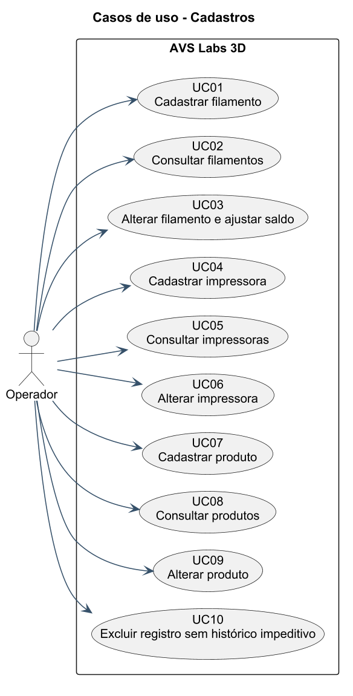

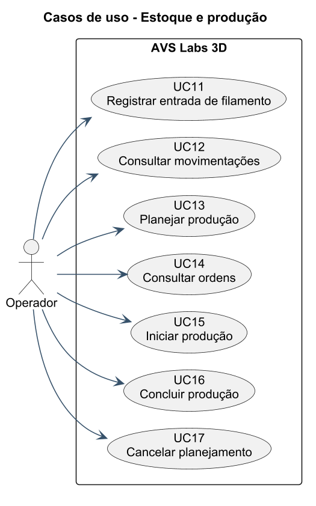

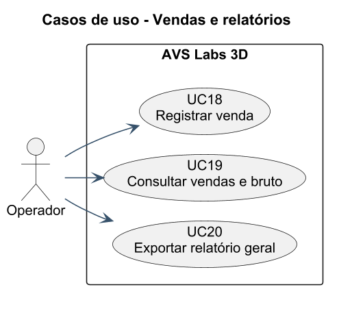

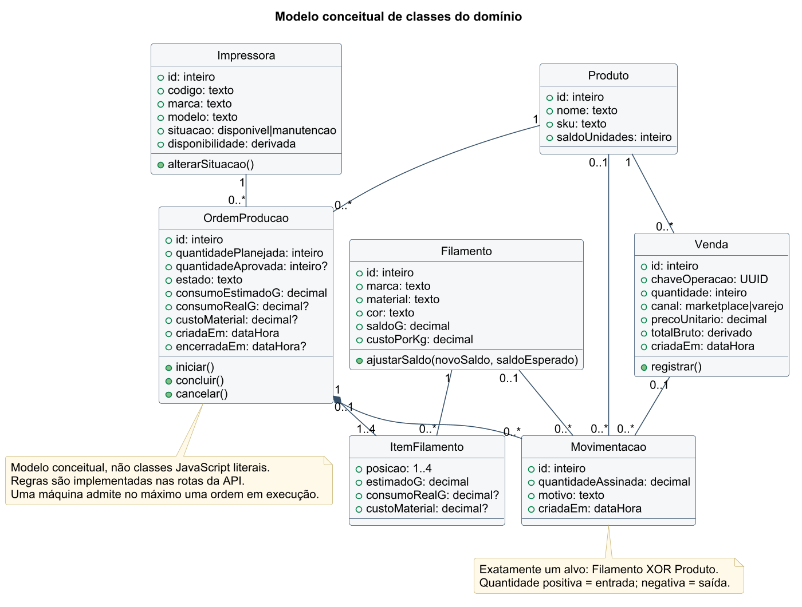

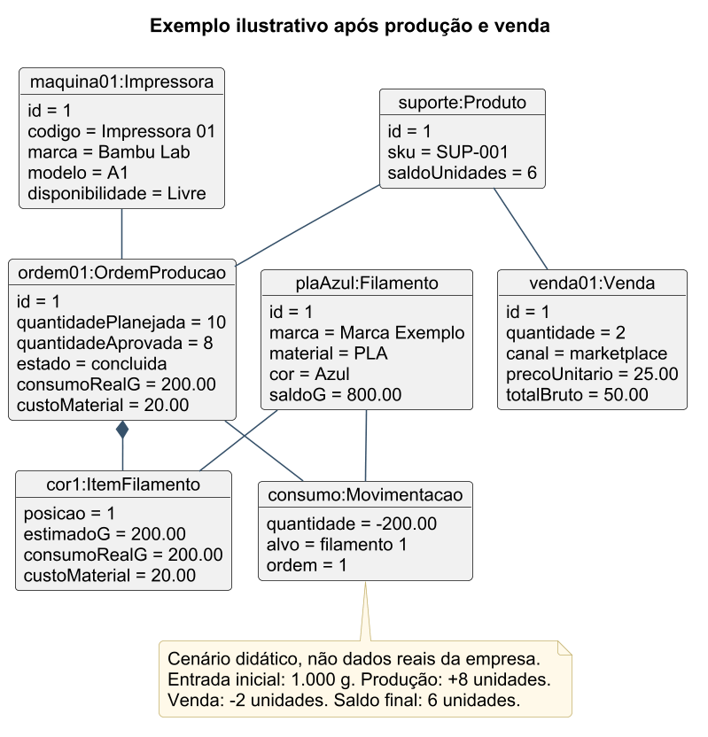

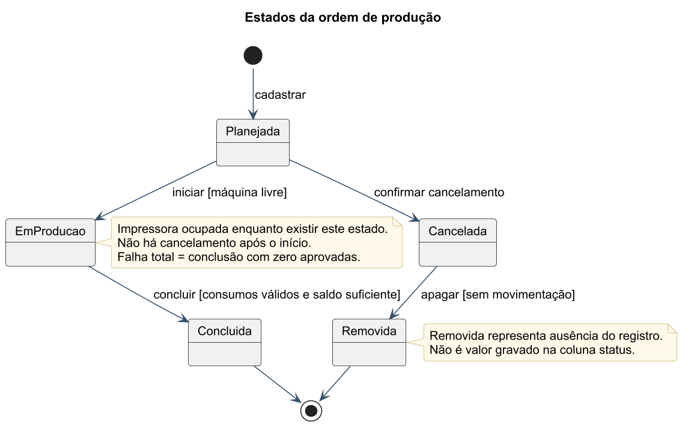

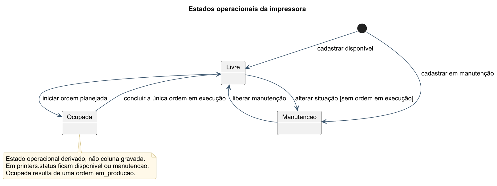

A ordem transita entre planejada, em_producao, concluida e cancelada. Removida, no desenho, representa exclusão do registro, não um quinto valor da coluna status. Livre/Ocupada na impressora é um estado operacional derivado; sua situação cadastral física continua disponivel/manutencao.

## Descrições essenciais e sequências

As sequências mostram o fluxo principal e as condições relevantes. Fragmentos break encerram o fluxo em falha; consultas auxiliares da interface foram omitidas. Cada caso corresponde a um evento externo do operador.

## UC01 - Cadastrar filamento

**Ator:** Operador. **Tipo:** externo. **Estímulo:** O operador envia o novo filamento.

**Entrada:** Marca, material, cor, custo por kg e saldo inicial em gramas.

**Pré-condições:** Aplicativo e banco disponíveis; saldo inicial não negativo, com até duas casas decimais.

**Pós-condições:** Cadastro criado; saldo inicial positivo gera uma entrada de estoque vinculada.

**Interface de implementação:** `POST /api/materials`.

**Dados envolvidos:** materials; stock_movements.

### Fluxo principal

1. Abrir Materiais e acionar Novo cadastro.
2. Informar separadamente marca, material e cor; informar custo/kg e saldo inicial.
3. A interface converte os campos numéricos e envia JSON.
4. A API valida campos, abre transação e insere o cadastro.
5. Se o saldo inicial for maior que zero, atualizar o saldo e inserir a entrada inicial.
6. Confirmar a transação e exibir cadastro atualizado.

### Fluxos alternativos e exceções

- Saldo inicial zero é aceito sem movimento.
- Campos vazios, valor negativo ou precisão superior a centésimos retornam 400.
- Falha na entrada inicial reverte também o cadastro.

### Diagrama de sequência

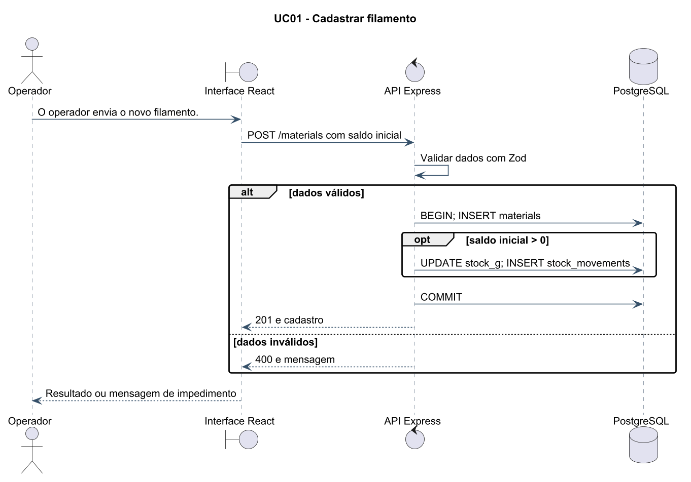

## UC02 - Consultar filamentos

**Ator:** Operador. **Tipo:** externo. **Estímulo:** O operador abre Materiais ou pesquisa.

**Entrada:** Texto de busca opcional, aplicado na interface.

**Pré-condições:** Banco disponível.

**Pós-condições:** Cadastros e saldos exibidos sem alteração de dados.

**Interface de implementação:** `GET /api/materials`.

**Dados envolvidos:** materials.

### Fluxo principal

1. Abrir a seção Materiais.
2. Solicitar a lista de filamentos à API.
3. Consultar todos os registros ordenados pelo ID decrescente.
4. Exibir marca, material/cor, saldo e custo/kg.
5. Filtrar localmente os registros conforme a busca.

### Fluxos alternativos e exceções

- Sem cadastros, mostrar estado vazio.
- Busca sem correspondência não altera o banco.
- Falha de conexão deve ser exibida na interface.

### Diagrama de sequência

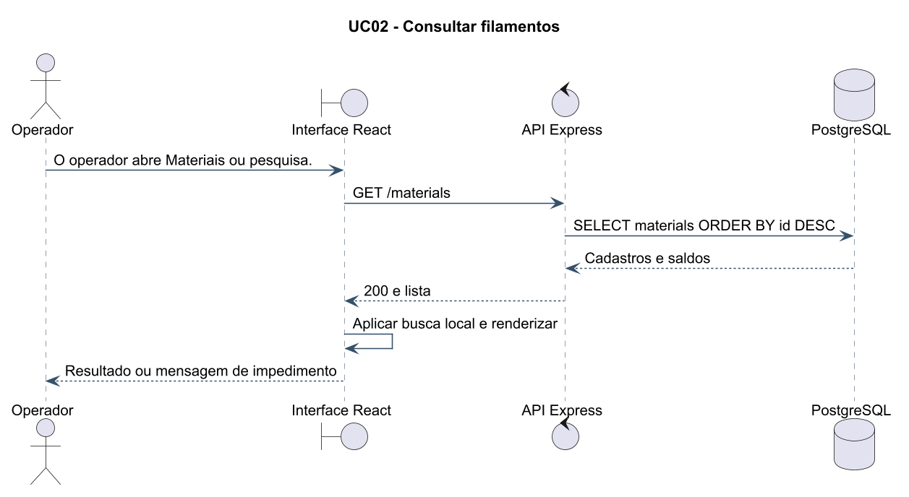

## UC03 - Alterar filamento e ajustar saldo

**Ator:** Operador. **Tipo:** externo. **Estímulo:** O operador salva a edição.

**Entrada:** ID, dados cadastrais e, se ajustar, stock_g e expected_stock_g.

**Pré-condições:** Registro existente; valores válidos; saldo anterior ainda corresponde ao banco.

**Pós-condições:** Cadastro atualizado; diferença de saldo registrada sem apagar movimentos anteriores.

**Interface de implementação:** `PUT /api/materials/:id`.

**Dados envolvidos:** materials; stock_movements.

### Fluxo principal

1. Abrir Editar e carregar o saldo atual como referência.
2. Alterar os dados e, se necessário, o saldo total disponível.
3. Enviar JSON com o saldo anterior exibido.
4. Abrir transação e bloquear o filamento com SELECT FOR UPDATE.
5. Comparar expected_stock_g com o saldo atual; calcular a diferença em centésimos.
6. Atualizar o cadastro e registrar movimento somente se a diferença for distinta de zero.
7. Confirmar e atualizar a tela.

### Fluxos alternativos e exceções

- Registro inexistente retorna 404.
- Saldo mudou durante a edição: retornar 409 e solicitar reabertura.
- Saldo negativo ou falta da referência anterior ao ajustar: retornar 400.
- Salvar sem mudar o saldo não cria movimento.

### Diagrama de sequência

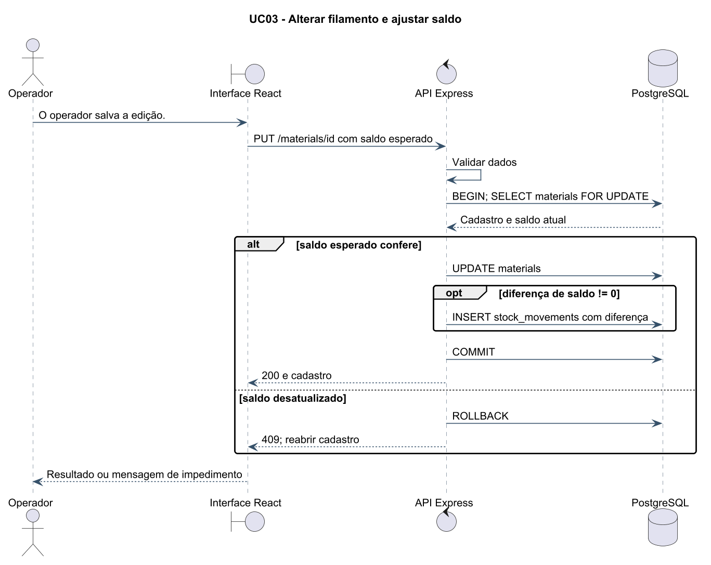

## UC04 - Cadastrar impressora

**Ator:** Operador. **Tipo:** externo. **Estímulo:** O operador envia o cadastro da máquina.

**Entrada:** Código, marca, modelo e situação disponível/manutenção.

**Pré-condições:** Código não utilizado, inclusive com diferença apenas de caixa.

**Pós-condições:** Máquina identificada por código único.

**Interface de implementação:** `POST /api/printers`.

**Dados envolvidos:** printers.

### Fluxo principal

1. Abrir Impressoras e Novo cadastro.
2. Preencher código da unidade, marca, modelo e situação.
3. Validar os campos e inserir em transação.
4. Confirmar e retornar a nova impressora.

### Fluxos alternativos e exceções

- Código duplicado retorna 409.
- Campos vazios ou situação inválida retornam 400.

### Diagrama de sequência

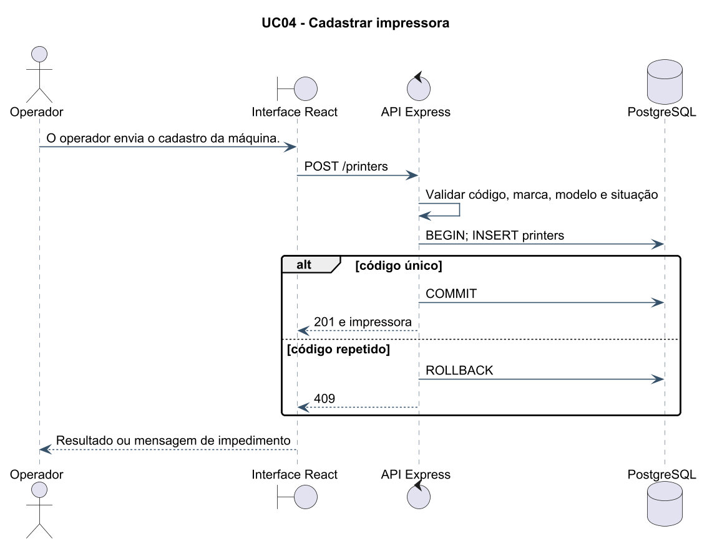

## UC05 - Consultar impressoras

**Ator:** Operador. **Tipo:** externo. **Estímulo:** O operador abre Impressoras.

**Entrada:** Busca local opcional.

**Pré-condições:** Banco disponível.

**Pós-condições:** Exibição de Livre, Ocupada ou Manutenção.

**Interface de implementação:** `GET /api/printers`.

**Dados envolvidos:** printers; production_orders.

### Fluxo principal

1. Consultar cadastros de impressoras.
2. Verificar se há ordem em_producao vinculada a cada máquina.
3. Se o cadastro estiver em manutenção, apresentar Manutenção; caso contrário, Ocupada quando houver ordem em execução e Livre nos demais casos.
4. Exibir e permitir busca por código, marca e modelo.

### Fluxos alternativos e exceções

- Impressora planejada, sem execução, continua livre.
- A disponibilidade é calculada na consulta; não é uma coluna gravada.

### Diagrama de sequência

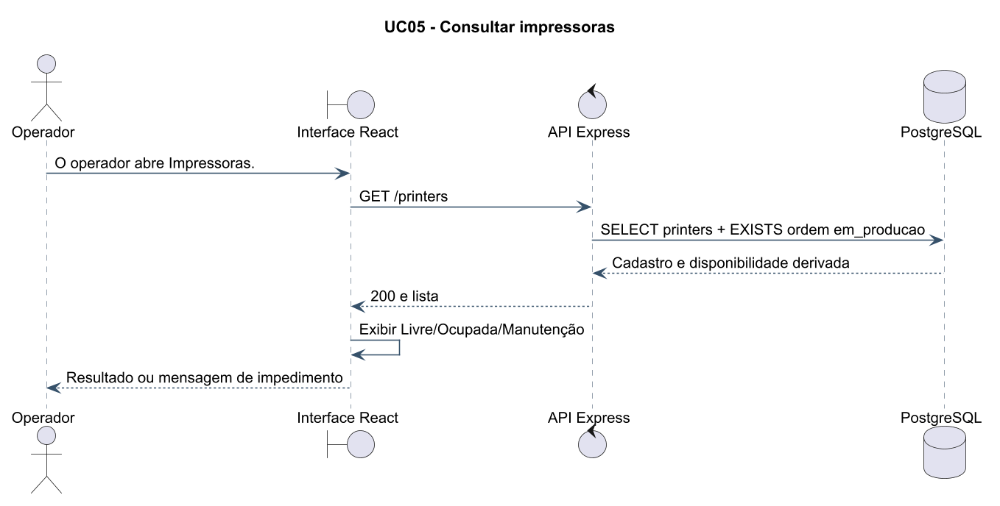

## UC06 - Alterar impressora

**Ator:** Operador. **Tipo:** externo. **Estímulo:** O operador salva a edição da máquina.

**Entrada:** Código, marca, modelo e situação.

**Pré-condições:** Impressora existente e código único.

**Pós-condições:** Dados atualizados; histórico de ordens mantém o mesmo ID.

**Interface de implementação:** `PUT /api/printers/:id`.

**Dados envolvidos:** printers; production_orders.

### Fluxo principal

1. Abrir a edição da impressora.
2. Enviar os dados alterados.
3. Bloquear o cadastro na transação.
4. Se a nova situação for manutenção, consultar se há produção ativa.
5. Atualizar e confirmar quando não houver impedimento.

### Fluxos alternativos e exceções

- Não é permitido colocar em manutenção uma impressora com produção ativa: 409.
- Código duplicado: 409.
- Não encontrada: 404.

### Diagrama de sequência

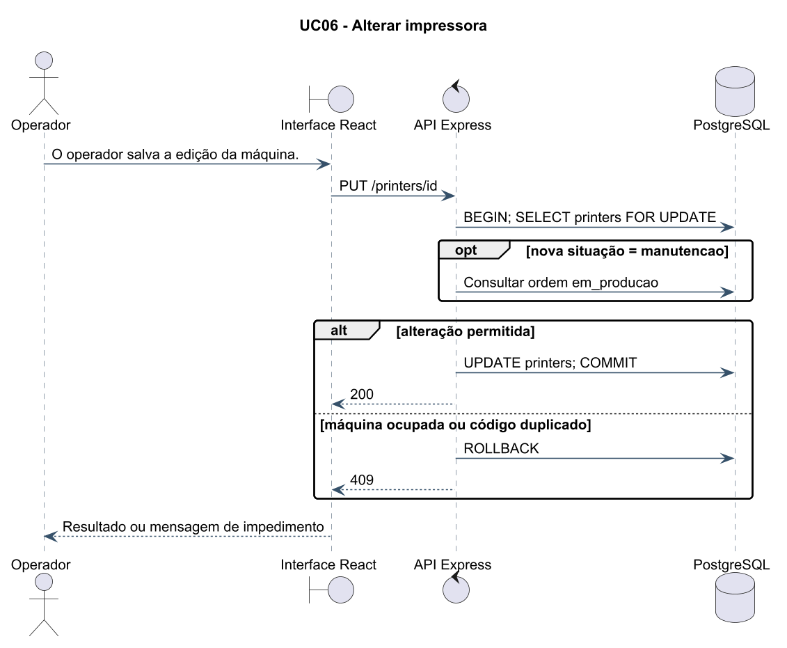

## UC07 - Cadastrar produto

**Ator:** Operador. **Tipo:** externo. **Estímulo:** O operador envia um novo produto.

**Entrada:** Nome e SKU.

**Pré-condições:** SKU único e campos não vazios.

**Pós-condições:** Produto criado com estoque zero.

**Interface de implementação:** `POST /api/products`.

**Dados envolvidos:** products.

### Fluxo principal

1. Abrir Produtos e Novo cadastro.
2. Informar nome e SKU.
3. Validar e inserir o produto em transação.
4. Confirmar cadastro com stock_units igual a zero.

### Fluxos alternativos e exceções

- SKU duplicado retorna 409.
- O saldo de produto entra pela conclusão de produção, não por saldo inicial neste cadastro.

### Diagrama de sequência

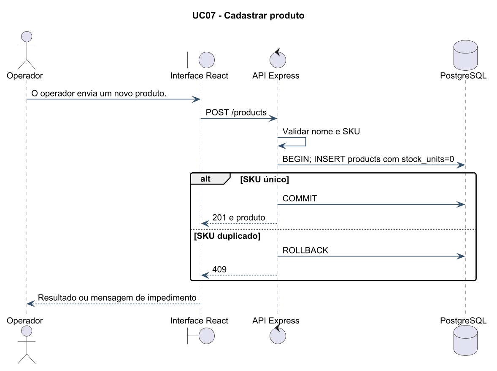

## UC08 - Consultar produtos

**Ator:** Operador. **Tipo:** externo. **Estímulo:** O operador abre Produtos.

**Entrada:** Busca local opcional.

**Pré-condições:** Banco disponível.

**Pós-condições:** Lista de produtos e estoque disponível em unidades.

**Interface de implementação:** `GET /api/products`.

**Dados envolvidos:** products.

### Fluxo principal

1. Solicitar a lista de produtos.
2. Consultar cadastros ordenados pelo ID.
3. Exibir nome, SKU e stock_units.
4. Aplicar filtro local quando houver busca.

### Fluxos alternativos e exceções

- Estoque zero é exibido, mas o produto não aparece como opção de venda disponível.

### Diagrama de sequência

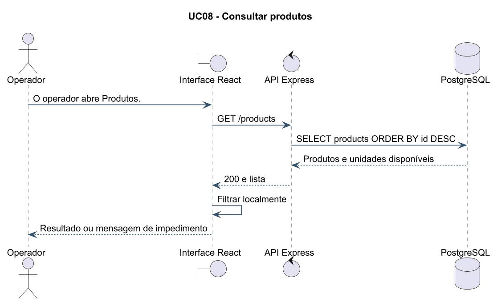

## UC09 - Alterar produto

**Ator:** Operador. **Tipo:** externo. **Estímulo:** O operador salva uma alteração de nome ou SKU.

**Entrada:** Nome e SKU.

**Pré-condições:** Produto existente; SKU único.

**Pós-condições:** Dados atualizados sem mudar o saldo.

**Interface de implementação:** `PUT /api/products/:id`.

**Dados envolvidos:** products.

### Fluxo principal

1. Abrir Editar em Produtos.
2. Modificar nome ou SKU.
3. Validar e bloquear o registro.
4. Atualizar somente os campos permitidos.
5. Confirmar e atualizar a lista.

### Fluxos alternativos e exceções

- Enviar stock_units na edição é rejeitado pelo contrato estrito.
- SKU duplicado retorna 409; ID inexistente retorna 404.

### Diagrama de sequência

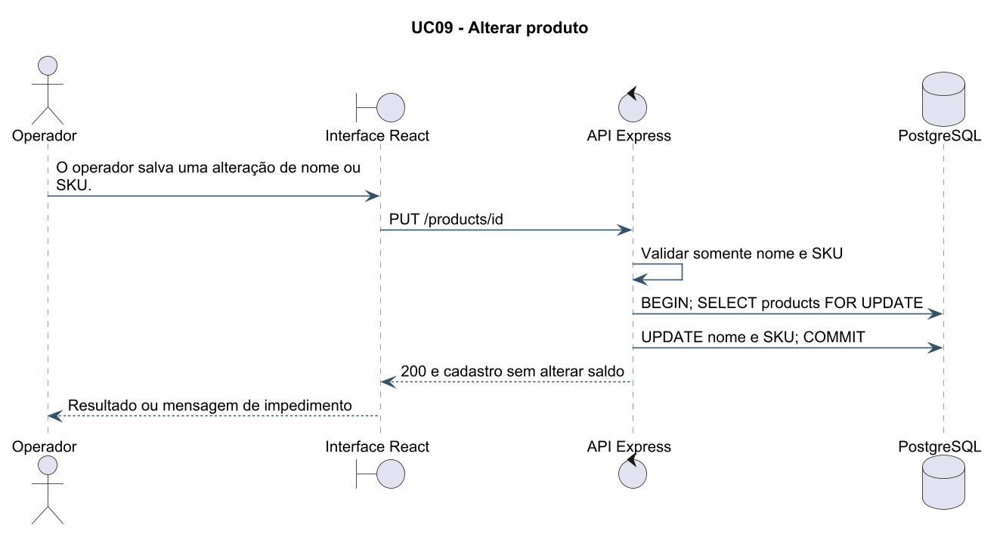

## UC10 - Excluir registro sem histórico impeditivo

**Ator:** Operador. **Tipo:** externo. **Estímulo:** O operador confirma a exclusão.

**Entrada:** Tipo de registro e ID.

**Pré-condições:** Cadastro sem vínculos; para ordem, estado cancelada e ausência de movimentos.

**Pós-condições:** Registro removido; exclusão de ordem remove também seus itens de filamento.

**Interface de implementação:** `DELETE /api/{materials|printers|products}/:id; DELETE /api/orders/:id`.

**Dados envolvidos:** materials/printers/products ou production_orders + production_order_materials.

### Fluxo principal

1. Acionar Excluir no cadastro ou Apagar em uma ordem cancelada.
2. Apresentar a confirmação e permitir Voltar.
3. Confirmar o tipo de recurso e o ID.
4. Em cadastro, executar DELETE e deixar as chaves estrangeiras impedirem remoção com vínculos.
5. Em ordem, abrir transação, bloquear a ordem, validar o cancelamento e ausência de movimentos, remover os itens e a ordem.
6. Retornar 204 e atualizar a lista.

### Fluxos alternativos e exceções

- Voltar não exclui dados.
- Vínculos ou situação incompatível retornam 409.
- ID inexistente retorna 404.
- Vendas e movimentações não possuem exclusão na interface.

### Diagrama de sequência

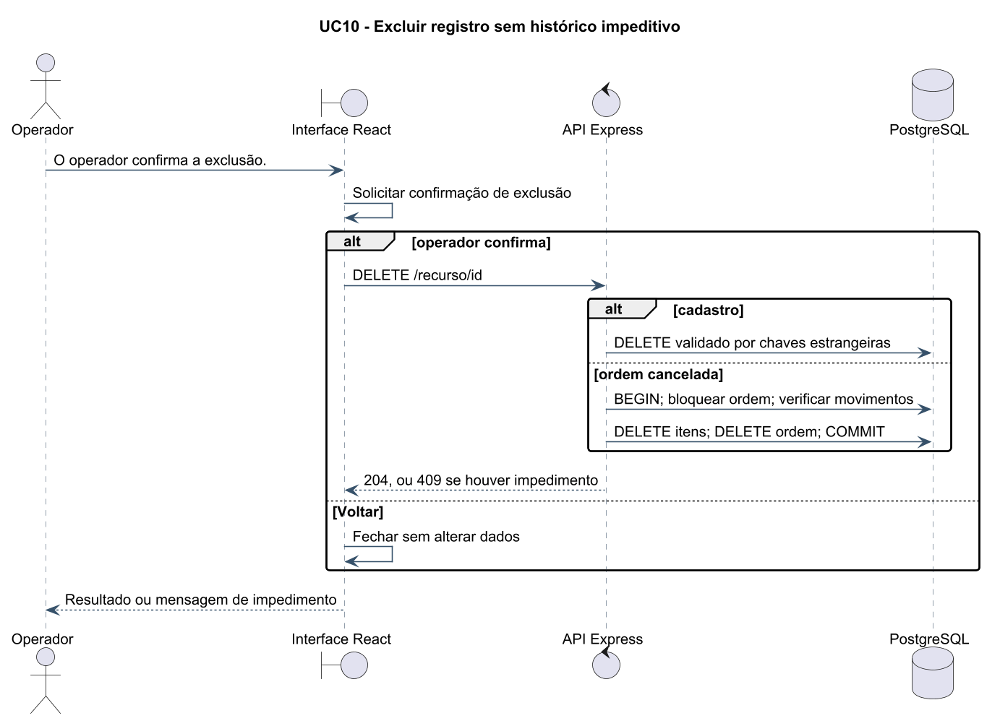

## UC11 - Registrar entrada de filamento

**Ator:** Operador. **Tipo:** externo. **Estímulo:** O operador confirma uma reposição.

**Entrada:** ID do filamento, quantidade positiva em gramas e motivo.

**Pré-condições:** Filamento existente; quantidade até 10.000.000 g, com duas casas.

**Pós-condições:** Saldo acrescido e entrada registrada na mesma transação.

**Interface de implementação:** `POST /api/stock-entry`.

**Dados envolvidos:** materials; stock_movements.

### Fluxo principal

1. Abrir Entrada de estoque.
2. Selecionar o filamento identificado por marca/material/cor.
3. Informar quantidade e motivo.
4. Bloquear o cadastro em transação.
5. Somar a quantidade ao saldo e inserir movimento positivo.
6. Confirmar e atualizar as telas.

### Fluxos alternativos e exceções

- Quantidade zero/negativa ou motivo vazio retorna 400.
- Reenvio desta entrada não possui chave de idempotência própria.

### Diagrama de sequência

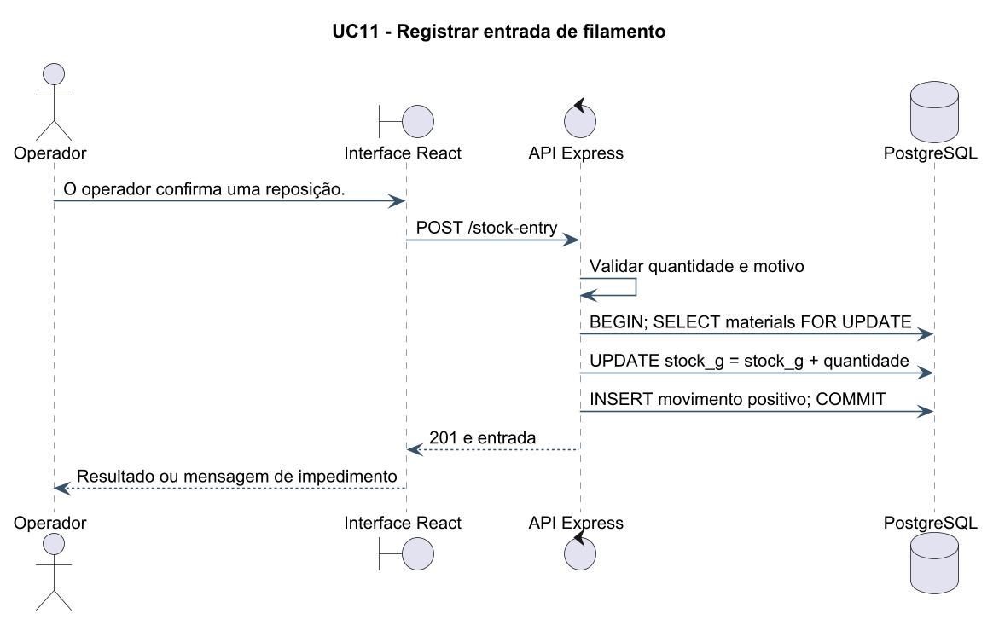

## UC12 - Consultar movimentações

**Ator:** Operador. **Tipo:** externo. **Estímulo:** O operador abre Movimentações.

**Entrada:** Busca local opcional.

**Pré-condições:** Banco disponível.

**Pós-condições:** Histórico de entradas, ajustes, produção e vendas exibido.

**Interface de implementação:** `GET /api/movements`.

**Dados envolvidos:** stock_movements; materials; products.

### Fluxo principal

1. Consultar movimentos em ordem decrescente de ID.
2. Juntar a descrição do filamento ou produto.
3. Exibir quantidade positiva/negativa, motivo, data e referência de ordem ou venda.
4. Permitir busca sem alterar registros.

### Fluxos alternativos e exceções

- Movimento de filamento usa gramas; de produto, unidades.
- Registro não pode referenciar simultaneamente filamento e produto.

### Diagrama de sequência

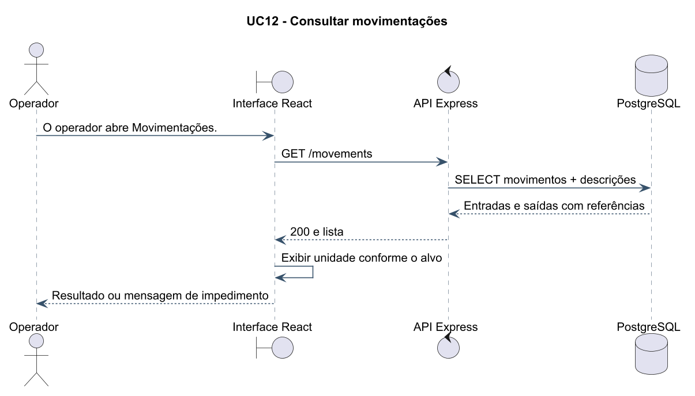

## UC13 - Planejar produção

**Ator:** Operador. **Tipo:** externo. **Estímulo:** O operador envia uma nova ordem.

**Entrada:** Produto, impressora, quantidade de peças e 1 a 4 pares filamento/consumo estimado.

**Pré-condições:** Produto e filamentos existentes; impressora livre e fora de manutenção.

**Pós-condições:** Ordem planejada, itens gravados e estoques preservados.

**Interface de implementação:** `POST /api/orders`.

**Dados envolvidos:** production_orders; production_order_materials; printers.

### Fluxo principal

1. Abrir Nova ordem e selecionar produto.
2. Selecionar marca/modelo de impressora e uma unidade livre pelo código.
3. Informar quantidade de peças.
4. Para cada filamento, selecionar separadamente marca, material e cor e informar consumo estimado.
5. Validar de um a quatro filamentos distintos.
6. Bloquear a impressora, conferir disponibilidade, inserir ordem e itens.
7. Confirmar o planejamento; a impressora só passa a ocupada no início efetivo.

### Fluxos alternativos e exceções

- Filamento repetido, zero ou mais de quatro itens retornam 400.
- Impressora ocupada/manutenção retorna 409.
- Não há reserva nem baixa de filamento no planejamento.

### Diagrama de sequência

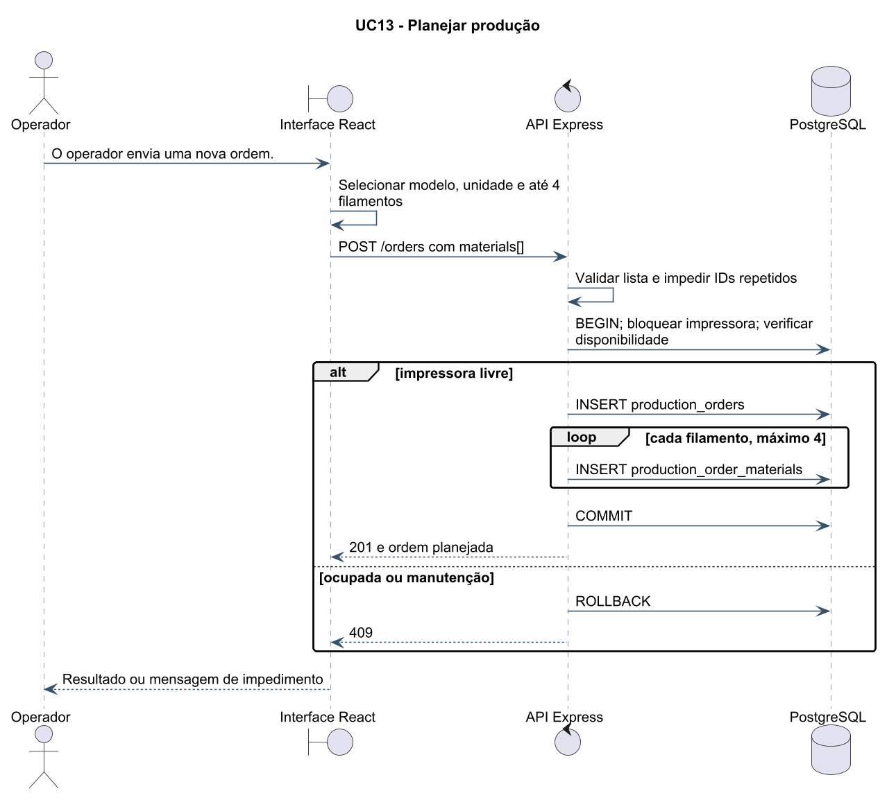

## UC14 - Consultar ordens

**Ator:** Operador. **Tipo:** externo. **Estímulo:** O operador abre Produção ou busca uma ordem.

**Entrada:** Busca local opcional.

**Pré-condições:** Banco disponível.

**Pós-condições:** Ordens com impressora, itens, quantidades, custos e estados.

**Interface de implementação:** `GET /api/orders`.

**Dados envolvidos:** production_orders; production_order_materials; materials; products; printers.

### Fluxo principal

1. Consultar ordens com produto e impressora.
2. Consultar os itens dos filamentos.
3. Agrupar itens por order_id na API.
4. Exibir os filamentos de cada ordem, consumo estimado/real e custo total quando concluída.
5. Mostrar ações conforme o estado.

### Fluxos alternativos e exceções

- Ordem planejada oferece Iniciar e Cancelar; em produção oferece Concluir; cancelada oferece Apagar.
- Os dois SELECTs desta consulta não usam snapshot comum; a exportação é a alternativa com leitura consistente.

### Diagrama de sequência

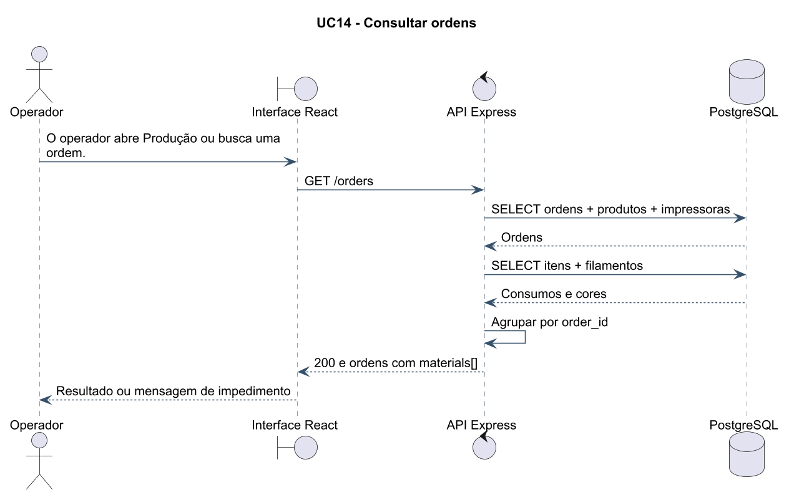

## UC15 - Iniciar produção

**Ator:** Operador. **Tipo:** externo. **Estímulo:** O operador aciona Iniciar.

**Entrada:** ID da ordem.

**Pré-condições:** Estado planejada e impressora disponível, sem outra ordem em produção.

**Pós-condições:** Estado em_producao; disponibilidade calculada como Ocupada.

**Interface de implementação:** `POST /api/orders/:id/start`.

**Dados envolvidos:** production_orders; printers.

### Fluxo principal

1. Acionar Iniciar na ordem planejada.
2. Abrir transação e bloquear a ordem.
3. Bloquear a impressora e consultar ordens em execução.
4. Alterar a ordem para em_producao.
5. Confirmar e recalcular disponibilidade na atualização da tela.

### Fluxos alternativos e exceções

- Ordem não planejada ou impressora indisponível retorna 409.
- Índice parcial único também impede duas ordens em execução na mesma impressora.
- A operação não altera estoque.

### Diagrama de sequência

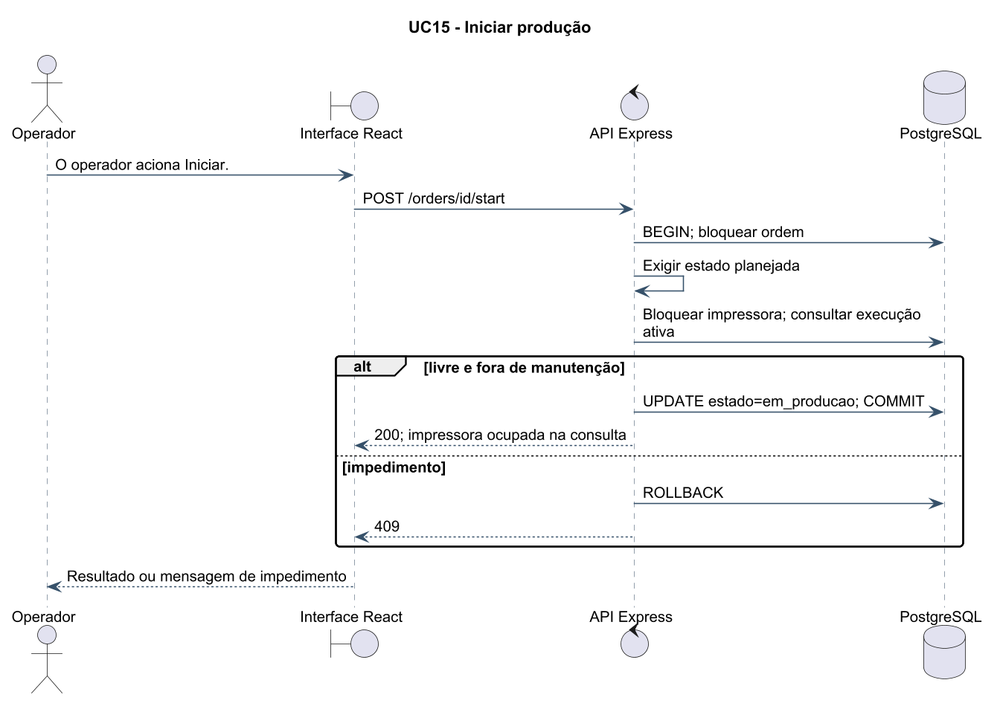

## UC16 - Concluir produção

**Ator:** Operador. **Tipo:** externo. **Estímulo:** O operador confirma consumos e peças aprovadas.

**Entrada:** ID, quantidade aprovada e consumo real de todos os filamentos da ordem.

**Pré-condições:** Ordem em_producao; aprovadas entre zero e planejadas; ao menos um consumo positivo; saldo suficiente em todas as cores.

**Pós-condições:** Consumos, custos, produto e movimentos confirmados uma única vez; impressora liberada.

**Interface de implementação:** `POST /api/orders/:id/finish`.

**Dados envolvidos:** production_orders; production_order_materials; materials; products; stock_movements.

### Fluxo principal

1. Abrir Concluir e informar o consumo real por filamento e peças aprovadas.
2. Bloquear a ordem e validar estado e composição exata dos filamentos.
3. Bloquear os filamentos em ordem crescente de ID para reduzir risco de deadlock.
4. Para cada cor, validar saldo, descontar consumo, gravar custo e movimento negativo quando houver consumo.
5. Acrescentar as peças aprovadas ao produto e criar entrada somente se a quantidade for positiva.
6. Somar consumos e custos dos itens, marcar concluída e gravar finished_at.
7. Confirmar tudo em uma transação; recalcular a disponibilidade da impressora.

### Fluxos alternativos e exceções

- Se qualquer saldo for insuficiente, reverter todos os itens: 409.
- Quantidade aprovada maior que planejada ou composição incorreta retorna 400.
- Falha total usa zero aprovadas e consumo positivo.
- Segunda conclusão retorna 409 e não duplica estoque.

### Diagrama de sequência

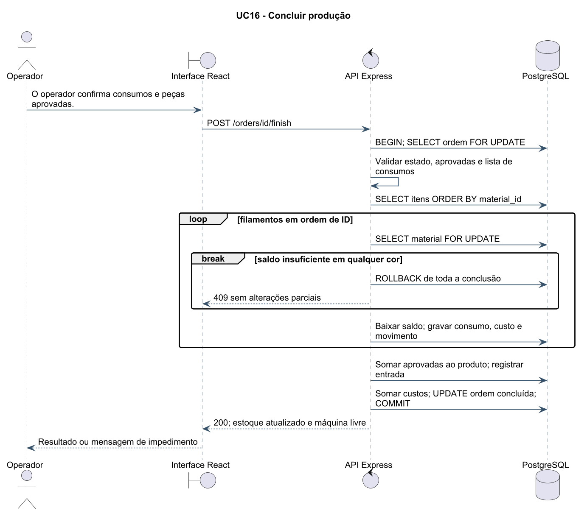

## UC17 - Cancelar planejamento

**Ator:** Operador. **Tipo:** externo. **Estímulo:** O operador confirma o cancelamento.

**Entrada:** ID da ordem planejada.

**Pré-condições:** Ordem existente e ainda planejada.

**Pós-condições:** Ordem cancelada com data de encerramento, sem movimentar estoque.

**Interface de implementação:** `POST /api/orders/:id/cancel`.

**Dados envolvidos:** production_orders.

### Fluxo principal

1. Acionar Cancelar e ler a confirmação.
2. Confirmar ou voltar.
3. Bloquear a ordem na transação.
4. Exigir estado planejada.
5. Gravar estado cancelada e finished_at e confirmar.

### Fluxos alternativos e exceções

- Em produção ou concluída não pode ser cancelada: 409.
- Falha de impressão iniciada é registrada pela conclusão, inclusive com zero aprovadas.

### Diagrama de sequência

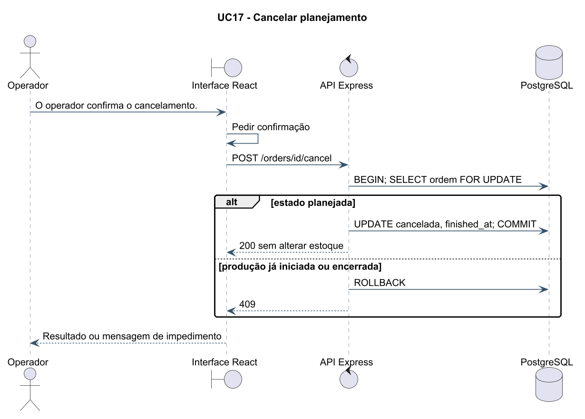

## UC18 - Registrar venda

**Ator:** Operador. **Tipo:** externo. **Estímulo:** O operador envia uma venda.

**Entrada:** UUID da operação, produto, quantidade inteira, canal e preço unitário positivo.

**Pré-condições:** Produto existente e saldo suficiente; canal marketplace ou varejo.

**Pós-condições:** Venda e saída de estoque confirmadas; total bruto calculado no banco.

**Interface de implementação:** `POST /api/sales`.

**Dados envolvidos:** sales; products; stock_movements.

### Fluxo principal

1. Abrir Vendas e Registrar venda.
2. Selecionar produto com estoque, quantidade, canal e preço unitário.
3. A interface exibe o total e gera request_id para aquela abertura do formulário.
4. Validar o JSON e consultar eventual venda com a mesma chave.
5. Bloquear o produto e repetir a consulta da chave depois do bloqueio.
6. Exigir saldo suficiente; inserir venda, baixar produto e gravar movimento com sale_id.
7. Confirmar e atualizar lista e faturamento bruto.

### Fluxos alternativos e exceções

- Reenvio com mesma chave e dados retorna a venda existente com 200 sem nova baixa.
- Chave reutilizada com dados diferentes retorna 409.
- Saldo insuficiente retorna 409 sem venda parcial.
- Quantidade/preço/canal inválidos retornam 400.

### Diagrama de sequência

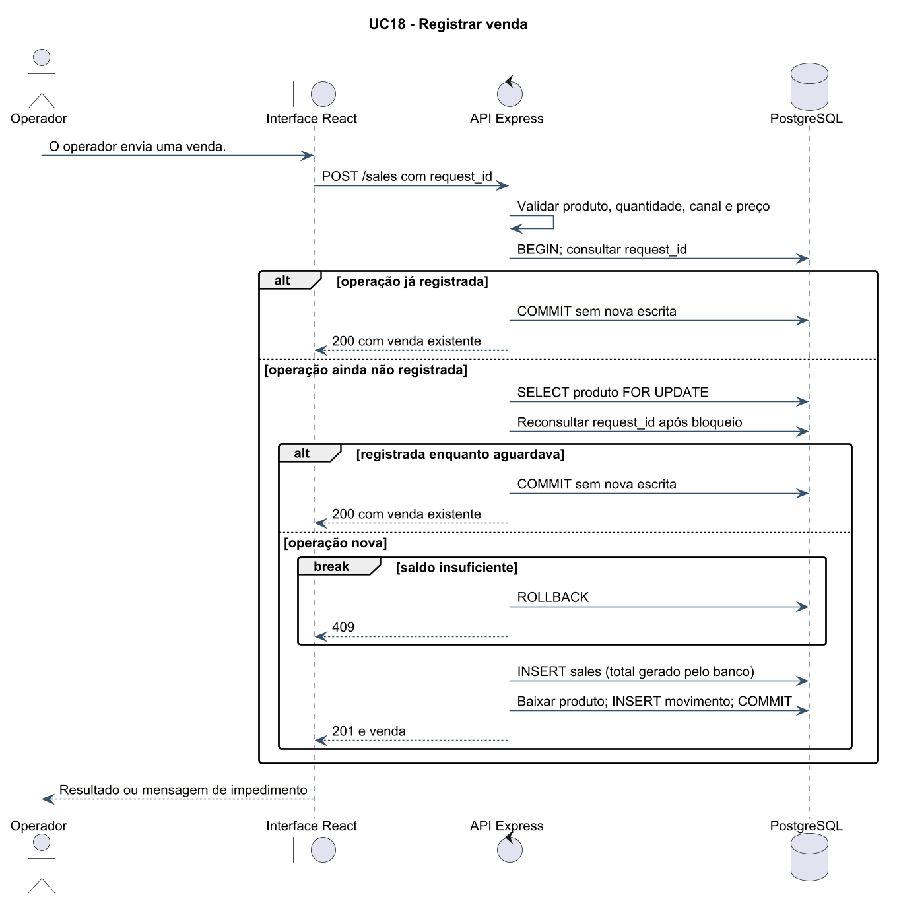

## UC19 - Consultar vendas e bruto

**Ator:** Operador. **Tipo:** externo. **Estímulo:** O operador abre Vendas ou usa a busca.

**Entrada:** Busca local opcional.

**Pré-condições:** Banco disponível.

**Pós-condições:** Histórico de vendas e bruto acumulado por canal exibidos.

**Interface de implementação:** `GET /api/sales`.

**Dados envolvidos:** sales; products.

### Fluxo principal

1. Solicitar vendas com descrição do produto e SKU.
2. Exibir data, canal, quantidade, preço unitário e total bruto.
3. Somar valores em centavos na interface para indicadores gerais e por canal.
4. Somar unidades vendidas.
5. Filtrar a tabela localmente; os indicadores permanecem acumulados sobre todas as vendas.

### Fluxos alternativos e exceções

- Não há dedução de taxa, custo, despesa ou cálculo de lucro.
- Sem vendas, indicadores ficam em zero e a tabela informa ausência de registros.

### Diagrama de sequência

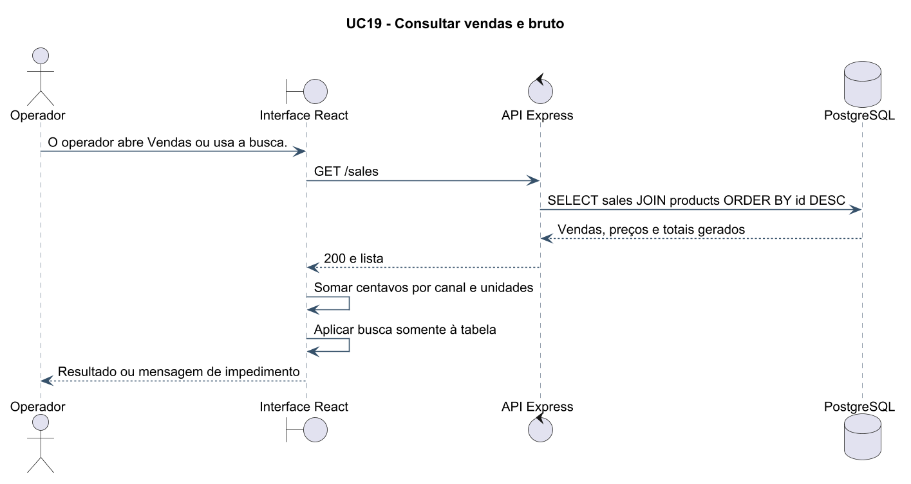

## UC20 - Exportar relatório geral

**Ator:** Operador. **Tipo:** externo. **Estímulo:** O operador aciona Exportar relatórios (CSV).

**Entrada:** Nenhum filtro: exportação completa.

**Pré-condições:** Banco disponível; navegador permite download.

**Pós-condições:** ZIP com oito CSVs e LEIA-ME baixado, sem alterar o banco.

**Interface de implementação:** `GET /api/reports/export`.

**Dados envolvidos:** Todas as sete tabelas, em leitura consistente.

### Fluxo principal

1. Acionar o botão disponível em todas as seções.
2. Abrir transação de leitura com REPEATABLE READ READ ONLY.
3. Consultar visão geral e sete conjuntos de dados, incluindo consumos detalhados.
4. Codificar CSV em UTF-8 com BOM, ponto e vírgula e vírgula decimal.
5. Escapar aspas e proteger campos textuais com prefixo de fórmula.
6. Gerar ZIP e retornar com Content-Disposition e Cache-Control no-store.
7. Criar download no navegador e liberar a URL temporária posteriormente.

### Fluxos alternativos e exceções

- CSV não contém abas: cada seção é um arquivo no ZIP.
- A busca da tela não limita a exportação.
- Falha retorna mensagem sem alterar dados.
- Datas em ISO 8601 UTC; dados vazios continuam vazios.

### Diagrama de sequência

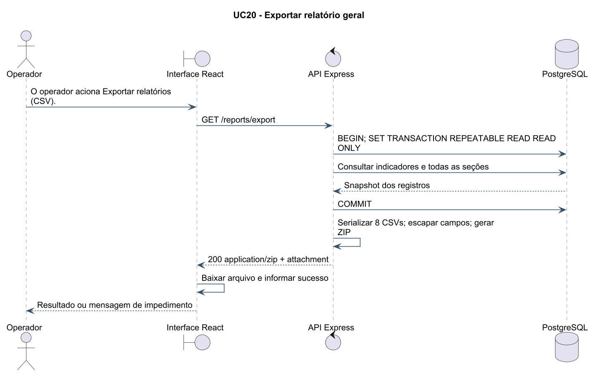
