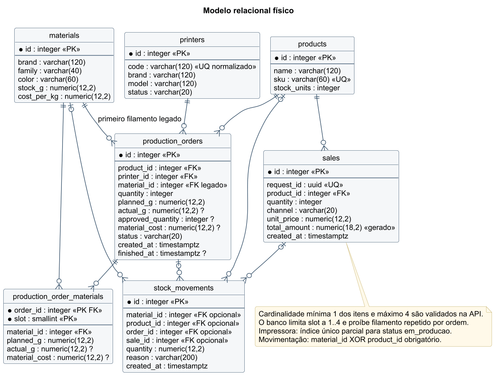

# Modelagem e implementação da base de dados

## Banco escolhido e orientação da disciplina

A base implementada é PostgreSQL 18, conforme orientação posterior do professor informada pelo aluno. O enunciado original da fase 3 mencionava MySQL Workbench. O grupo deverá informar essa substituição na entrega; o script atual não deve ser apresentado como script MySQL nem como arquivo nativo do Workbench.

A ferramenta de inspeção pode ser pgAdmin ou DBeaver. A execução do esquema ocorre pelo script database/schema.sql e pelo comando npm run db:setup. O programa não depende de Supabase.

## Entidades e relacionamentos

São sete tabelas: materials, printers, products, production_orders, production_order_materials, stock_movements e sales. Uma ordem pertence a um produto e uma impressora. Seus itens vinculam de um a quatro filamentos. Movimentações registram entrada/saída de filamento ou produto e podem referenciar ordem ou venda. Vendas pertencem a produtos.

A chave composta de production_order_materials é (order_id, slot). Há unicidade de filamento por ordem. O cabeçalho mantém material_id como referência legada ao primeiro item; os itens são a fonte completa para multicor. Quantidades e valores monetários persistem em tipos numéricos apropriados, e total_amount da venda é calculado pelo banco.

## Arquivos que acompanham esta fase

- database/schema.sql: criação e atualização compatível do esquema, com comentários.
- docs/tecnica/04-banco-de-dados.md: descrição das sete tabelas, dos 49 campos e das restrições.
- docs/tecnica/dicionario-dados.json: metadados editáveis dos campos.
- docs/uml/07-modelo-relacional.puml: fonte do diagrama físico.
- docs/uml/07-modelo-relacional.svg e .png: figuras renderizadas.
- database/consultas-demonstracao.sql: consultas de leitura para apresentar dados e conferir saldos.

## Implementação e demonstração

1. Criar o banco vazio avslabs_pi ou iniciar o PostgreSQL pelo Docker Compose.
2. Configurar DATABASE_URL no arquivo .env, sem enviar senhas reais ao Git.
3. Executar npm run db:setup.
4. Conferir as sete tabelas e seus relacionamentos na ferramenta de banco.
5. Demonstrar os dados gerados pelo roteiro da fase 4.
6. Mostrar que FKs impedem remover cadastros com histórico e que duas execuções não podem usar a mesma impressora simultaneamente.

O esquema também contém CHECKs de estoque não negativo, alvos exclusivos de movimentação e estados permitidos. Parte das regras permanece na API: lista exata de filamentos, quantidade mínima de um item, transições, idempotência e validação de consumo por cor. Não se atribui ao banco uma garantia que depende dessas rotas.
