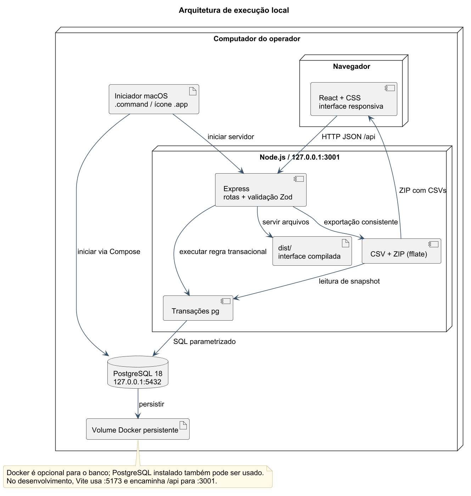

# Arquitetura e fluxos internos

## Visão arquitetural

A solução adota separação física entre apresentação, API e persistência. É um monólito local simples: o mesmo processo Express atende rotas de negócio e arquivos estáticos de produção. Não é uma arquitetura de microsserviços nem uma implementação completa de Clean Architecture. As regras estão concentradas em `server/app.js`; não existe ORM, camada de entidades JavaScript persistentes ou repositórios separados nesta edição.

Em desenvolvimento, Vite atende `127.0.0.1:5173` e encaminha `/api` para `127.0.0.1:3001`. Em produção local, `npm run build` produz `dist/`, e `npm start` atende interface e API em `127.0.0.1:3001`. A aplicação usa navegação por estado React, não rotas de URL para cada seção.

## Apresentação

`App` controla a seção ativa, os dados carregados, a pesquisa, o diálogo, o formulário e os estados de envio/exportação. `SalesPanel` apresenta o histórico comercial e indicadores brutos. O componente raiz possui metadados de campos para os três cadastros; listas e formulários são montados a partir desses metadados.

`refresh` chama os endpoints das seções com `Promise.all` e atualiza o estado. A busca é feita no navegador, sobre os dados já carregados. Não existe paginação no backend. Abrir a produção também atualiza as opções para reduzir uso de disponibilidades antigas; a API faz a validação decisiva antes de gravar.

`open` inicializa o formulário apropriado. Na edição de filamento, copia também `expected_stock_g`. Na venda, gera um UUID novo para aquela abertura. Para produção, `filaments` contém linhas com chave estável, marca, material, ID do cadastro de cor e consumo estimado. Alterar marca limpa material/cor; alterar material limpa cor. IDs já selecionados ficam desabilitados nas outras linhas.

`save` converte entradas numéricas e constrói o JSON de cada caso. `act` bloqueia o envio, chama a operação, fecha o diálogo e atualiza as listas quando há sucesso. Erros da API são apresentados sem fechar o formulário. Isso permite corrigir estoque ou quantidade sem perder imediatamente o que foi digitado.

Os diálogos têm título acessível, fechamento por Escape, restauração de foco e circulação do foco pelos controles. Botões de salvar são desabilitados durante o envio. A validação HTML ajuda a preencher, mas não substitui a validação Zod no servidor.

## API e injeção de dependências

`createApp({ pool, transaction })` constrói o Express. Em execução normal usa o pool PostgreSQL e o helper de `server/db.js`. Nos testes, recebe adaptadores equivalentes para PGlite ou uma base PostgreSQL temporária. A API pode ser testada sem iniciar o servidor principal ou usar dados reais do operador.

Os contratos são objetos Zod estritos: campos não previstos são rejeitados. O CRUD comum itera apenas pelas tabelas presentes no objeto `schemas`. Nomes de tabela/coluna interpolados vêm desse conjunto fechado e das chaves validadas, enquanto valores do usuário usam placeholders `$1`, `$2` etc. O cliente nunca fornece diretamente um identificador SQL arbitrário.

As operações de estoque e produção usam transações. `row` executa `SELECT ... FOR UPDATE`, exige existência e retorna o registro bloqueado. `transaction` abre uma conexão, executa BEGIN, confirma somente se o callback terminar sem erro, reverte em caso de exceção e sempre libera a conexão no `finally`.

## Fluxo de saldo inicial e ajustes

No cadastro do filamento, o saldo inicial é opcional e padrão zero. Saldo positivo gera cadastro, alteração de saldo e movimento de entrada em uma transação. Saldo zero não cria movimento com quantidade zero, que seria proibido pela restrição do banco.

Na edição, o novo saldo é um total, não uma quantidade a somar. A API compara o saldo anterior enviado com o saldo corrente sob lock. Havendo divergência, responde 409. A diferença é calculada em centésimos para evitar resíduos de ponto flutuante no registro do ajuste. Somente diferença não nula gera movimentação positiva ou negativa. Os movimentos anteriores permanecem intactos.

## Fluxo de produção multicor

1. Planejar: bloquear a impressora, validar disponibilidade, inserir ordem e de um a quatro itens. Gravar o primeiro filamento no campo legado da ordem e o total estimado no cabeçalho.
2. Iniciar: bloquear ordem e impressora; exigir estado planejada e ausência de outra execução; mudar o estado para em_producao.
3. Concluir: bloquear a ordem; exigir o mesmo conjunto de filamentos; ordenar os locks por material_id; validar cada saldo e gravar consumo/custo/movimento.
4. Acrescentar o produto aprovado uma única vez. Zero aprovadas é permitido em falha total; o consumo total precisa ser positivo.
5. Atualizar totais do cabeçalho e estado concluida; confirmar a transação.

O custo de cada item é `round(consumo_g × custo_kg / 1000, 2)`, calculado em SQL. O cabeçalho soma os custos arredondados dos itens. O custo/kg usado é o valor cadastrado no momento da conclusão, não custo FIFO, média de compras ou uma configuração de preço de venda.

A sequência de locks por ID diminui o risco de deadlocks quando ordens consomem os mesmos filamentos em combinações diferentes. A ordem bloqueada impede segunda conclusão. O índice parcial único em `production_orders(printer_id)` para `status='em_producao'` reforça a exclusividade da máquina.

## Disponibilidade da impressora

`printers.status` guarda apenas disponivel ou manutencao. A consulta calcula availability: Manutenção prevalece; caso contrário, uma ordem em_producao implica Ocupada e a ausência implica Livre. Concluir a ordem libera a máquina pela mudança do estado da ordem. Não é necessário gravar manualmente um terceiro estado no cadastro.

Planejamento não reserva a impressora nem material. Duas ordens podem estar planejadas para a mesma máquina, mas apenas uma pode iniciar. Também não existe previsão de fila com datas ou programação automática.

## Fluxo de venda

A API valida request_id, produto, quantidade inteira, canal e preço. Consulta a chave, bloqueia o produto e consulta novamente a chave depois do lock. Um reenvio igual devolve a venda existente sem nova baixa. Uma operação nova exige estoque suficiente, insere venda, reduz unidades e grava saída vinculada. Tudo confirma em uma transação.

O banco gera `total_amount = quantity × unit_price` em coluna calculada. A tela soma os valores em centavos e agrupa Marketplace/Varejo. Os indicadores são sobre todas as vendas, mesmo quando a tabela é filtrada. Faturamento bruto não equivale a lucro nem a confirmação de recebimento.

## Fluxo de exportação

`exportReports` utiliza uma transação `REPEATABLE READ READ ONLY` para consultar indicadores e tabelas no mesmo snapshot. Isso evita montar um relatório em que a venda esteja confirmada em uma seção e o saldo ainda represente outra leitura temporal. A transação termina antes da compactação do ZIP.

O gerador cria oito CSVs e um LEIA-ME. As células são delimitadas por aspas; aspas internas são duplicadas; linhas usam CRLF; o separador é ponto e vírgula e números decimais usam vírgula. UTF-8 com BOM facilita a abertura em planilhas. Campos textuais com prefixo de fórmula recebem apóstrofo; números negativos de movimentação continuam números.

No navegador, o download é feito com Blob e URL temporária, posteriormente revogada. A exportação não grava relatórios no banco nem limita os dados à pesquisa da tela.

## Tratamento de erros e fronteiras

Zod retorna 400. Recursos inexistentes retornam 404. Falta de saldo, conflito de edição, código/SKU repetido, vínculos e transições incompatíveis retornam 409. Falha não mapeada retorna 500 com mensagem genérica para a interface e erro detalhado no console do servidor.

A consulta normal de ordens faz duas leituras independentes e pode observar atualizações entre elas. Para relatórios consistentes, usa-se a exportação. Cadastros e entradas de estoque não possuem a mesma proteção de reenvio por UUID das vendas. Não há promessa de processamento exatamente uma vez para todas as rotas.
