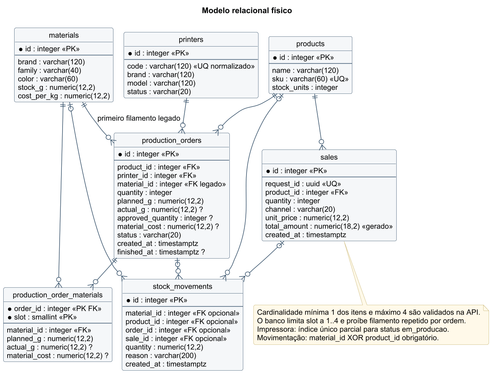

# Banco de dados e dicionário de dados

## Modelo relacional

O esquema possui sete tabelas no schema public. `database/schema.sql` é a fonte executável. Identificadores são inteiros identity; datas de eventos usam timestamptz; gramas e custos usam numeric. A tabela de itens resolve a relação entre ordens e filamentos. O campo material_id no cabeçalho da ordem foi mantido por compatibilidade e aponta para o primeiro item.



No diagrama, opcionalidade física é separada das regras de negócio. A API exige de um a quatro itens, mas uma FK isolada não obriga a existência de um filho. Da mesma forma, o índice único do slot limita a quantidade máxima física, enquanto a API garante a composição antes de confirmar o cadastro.


## Tabela materials

| Campo | Tipo e restrição | Aceita nulo | Significado |
|---|---|---|---|
| id | integer identity PK | Não | Identificador interno do filamento. |
| brand | varchar(120) | Não | Marca informada no cadastro. |
| family | varchar(40) | Não | Material/tipo: PLA, PETG, TPU etc.; não é enum fechado. |
| color | varchar(60) | Não | Cor descritiva do filamento. |
| stock_g | numeric(12,2), default 0 | Não | Saldo persistido em gramas, nunca negativo. |
| cost_per_kg | numeric(12,2), default 0 | Não | Custo por kg vigente no cadastro, não negativo. |

## Tabela printers

| Campo | Tipo e restrição | Aceita nulo | Significado |
|---|---|---|---|
| id | integer identity PK | Não | Identificador interno da máquina. |
| code | varchar(120) | Não | Código da unidade; índice único sobre lower(trim(code)). |
| brand | varchar(120) | Não | Marca da impressora; legado pode conter Não informada. |
| model | varchar(120) | Não | Modelo da impressora. |
| status | varchar(20), default disponivel | Não | Disponivel ou manutencao na grafia técnica minúscula definida no CHECK. |

## Tabela products

| Campo | Tipo e restrição | Aceita nulo | Significado |
|---|---|---|---|
| id | integer identity PK | Não | Identificador interno do produto. |
| name | varchar(120) | Não | Nome do produto. |
| sku | varchar(60), UNIQUE | Não | Código comercial do produto, único com comparação padrão do banco. |
| stock_units | integer, default 0 | Não | Estoque em unidades inteiras, não negativo. |

## Tabela production_orders

| Campo | Tipo e restrição | Aceita nulo | Significado |
|---|---|---|---|
| id | integer identity PK | Não | Identificador da ordem. |
| product_id | integer FK products | Não | Produto gerado pela ordem. |
| printer_id | integer FK printers | Não | Unidade de impressora escolhida. |
| material_id | integer FK materials | Não | Referência legada ao primeiro filamento; não substitui a coleção de itens. |
| quantity | integer | Não | Quantidade planejada de peças, maior que zero. |
| planned_g | numeric(12,2) | Não | Soma do consumo estimado dos itens. |
| actual_g | numeric(12,2) | Sim | Soma do consumo real; preenchida na conclusão. |
| approved_quantity | integer | Sim | Peças aprovadas, entre zero e quantity quando concluída. |
| material_cost | numeric(12,2) | Sim | Soma dos custos dos itens; snapshot da conclusão. |
| status | varchar(20), default planejada | Não | planejada, em_producao, concluida ou cancelada. |
| created_at | timestamptz, default now() | Não | Instante de criação definido no servidor de banco. |
| finished_at | timestamptz | Sim | Instante da conclusão ou do cancelamento. |

## Tabela production_order_materials

| Campo | Tipo e restrição | Aceita nulo | Significado |
|---|---|---|---|
| order_id | integer PK parcial, FK production_orders | Não | Ordem proprietária do item. |
| slot | smallint PK parcial | Não | Posição 1, 2, 3 ou 4. |
| material_id | integer FK materials | Não | Cadastro de filamento; combinação order_id/material_id é única. |
| planned_g | numeric(12,2) | Não | Consumo estimado positivo deste filamento. |
| actual_g | numeric(12,2) | Sim | Consumo real não negativo; zero se a cor não foi usada. |
| material_cost | numeric(12,2) | Sim | Custo calculado e arredondado por item na conclusão. |

## Tabela stock_movements

| Campo | Tipo e restrição | Aceita nulo | Significado |
|---|---|---|---|
| id | integer identity PK | Não | Identificador do lançamento. |
| material_id | integer FK materials | Sim | Alvo filamento; obrigatório quando product_id for nulo. |
| product_id | integer FK products | Sim | Alvo produto; obrigatório quando material_id for nulo. |
| order_id | integer FK production_orders | Sim | Ordem que originou consumo/produção. |
| sale_id | integer FK sales | Sim | Venda que originou a saída de produto. |
| quantity | numeric(12,2) | Não | Quantidade com sinal e diferente de zero: g para filamento ou un. para produto. |
| reason | varchar(200) | Não | Descrição da origem: saldo inicial, ajuste, entrada, produção ou venda. |
| created_at | timestamptz, default now() | Não | Instante do lançamento definido no banco. |

## Tabela sales

| Campo | Tipo e restrição | Aceita nulo | Significado |
|---|---|---|---|
| id | integer identity PK | Não | Identificador da venda. |
| request_id | uuid UNIQUE | Não | Identifica a tentativa de registro para proteção contra reenvio. |
| product_id | integer FK products | Não | Produto vendido. |
| quantity | integer | Não | Unidades vendidas, maior que zero. |
| channel | varchar(20) | Não | marketplace ou varejo. |
| unit_price | numeric(12,2) | Não | Preço unitário positivo. |
| total_amount | numeric(18,2), GENERATED STORED | Derivado | Resultado de quantity * unit_price calculado pelo banco. |
| created_at | timestamptz, default now() | Não | Instante de registro da venda. |

## Restrições e índices

- Chaves estrangeiras impedem remover filamento, impressora ou produto referenciado. Não há DELETE CASCADE automático nos vínculos descritos. A API apaga explicitamente os itens antes de apagar uma ordem cancelada.
- O CHECK de stock_movements exige exatamente um alvo, usando a soma dos indicadores de não nulidade. Isso impede alvo vazio e dupla referência ao mesmo tempo.
- O CHECK da ordem concluída exige actual_g positivo, approved_quantity válida, custo informado e finished_at preenchido. Outras validações, como correspondência da lista de consumos, são feitas na API.
- `one_running_order_per_printer` é índice único parcial de printer_id somente para ordens em_producao.
- `printers_code_unique` normaliza código com lower(trim(code)); produtos.sku usa UNIQUE padrão.
- `production_order_materials` tem PK(order_id, slot), CHECK(slot BETWEEN 1 AND 4) e UNIQUE(order_id, material_id).
- `sales.request_id` é único; total_amount é uma coluna armazenada gerada pelo banco.
- Há índices de apoio por data em movimentos e vendas. O código não cria todos os índices possíveis de FK nem implementa paginação; a configuração atende à escala local da entrega, sem benchmark de grande volume.

## Atualização compatível da estrutura

`npm run db:setup` lê o schema SQL dentro de uma transação. Em base vazia, cria as tabelas. Em bases anteriores, renomeia printers.name para code e materials.name para brand quando as colunas antigas existem. Adiciona a marca da impressora, trata nomes antigos duplicados com sufixo do ID, cria a tabela de itens e migra ordens antigas como um único item. Adiciona sales e sale_id ao histórico.

A execução repetida não deve duplicar os itens migrados. Não existe, porém, uma ferramenta completa de migrations versionadas com tabela de histórico, rollback de versão ou gerenciamento de todas as alterações futuras. CREATE TABLE IF NOT EXISTS não transforma arbitrariamente tabelas antigas. Mudanças adicionais precisam ser planejadas e testadas explicitamente.

Antes de alterações estruturais, use backup. Não copie a base real para testes automatizados. Os testes nativos criam e removem um banco próprio com nome temporário.

## Saldo armazenado e conciliação

Os saldos ficam em materials.stock_g e products.stock_units, atualizados junto com o movimento correspondente. Portanto, a listagem não recalcula o saldo pela soma do histórico em cada consulta. O histórico permite conciliar o valor persistido.

```sql
SELECT m.id, m.brand, m.family, m.color, m.stock_g,
       COALESCE(SUM(sm.quantity), 0) AS saldo_movimentos
FROM materials m
LEFT JOIN stock_movements sm ON sm.material_id = m.id
GROUP BY m.id
HAVING m.stock_g <> COALESCE(SUM(sm.quantity), 0);

SELECT p.id, p.name, p.stock_units,
       COALESCE(SUM(sm.quantity), 0) AS saldo_movimentos
FROM products p
LEFT JOIN stock_movements sm ON sm.product_id = p.id
GROUP BY p.id
HAVING p.stock_units <> COALESCE(SUM(sm.quantity), 0);
```

Essas consultas são diagnósticas: resultado vazio indica conciliação das linhas consultadas. Não alteram o banco. Alterações manuais fora da API podem quebrar a igualdade; não existe trigger que bloqueie qualquer acesso administrativo ou reconstrua automaticamente o saldo.

## Precisão, unidades e custo

Quantidade de filamento usa gramas e duas casas. Não é necessário converter um rolo de 1 kg para uma unidade de rolo: informe 1000 g. Quantidade do produto é inteira. O preço e os custos monetários usam reais em numeric, não float no PostgreSQL.

Exemplo de uma cor: 200 g a R$ 100/kg resultam em R$ 20,00 de material. Em quatro cores, cada item é arredondado para duas casas e o cabeçalho soma esses valores. Preço de venda não é obtido desse custo automaticamente. Faturamento de 2 peças a R$ 25,00 é R$ 50,00 bruto.

Na interface, saldos e valores são formatados em pt-BR. Na API, numeric pode ser serializado pelo driver como string, preservando precisão na fronteira. A interface converte para Number quando calcula ou formata; totais de vendas são somados em centavos para reduzir resíduos. No CSV, usa-se vírgula decimal e ausência de separador de milhar.
