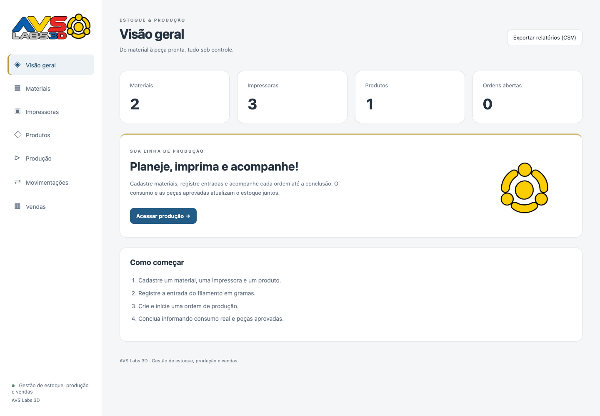
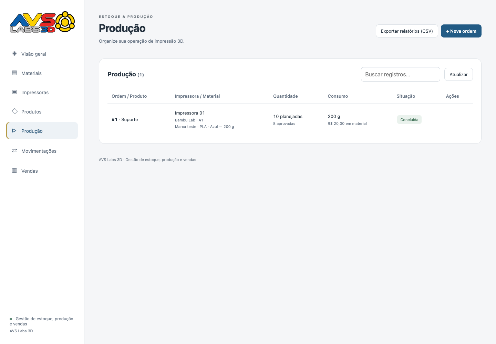
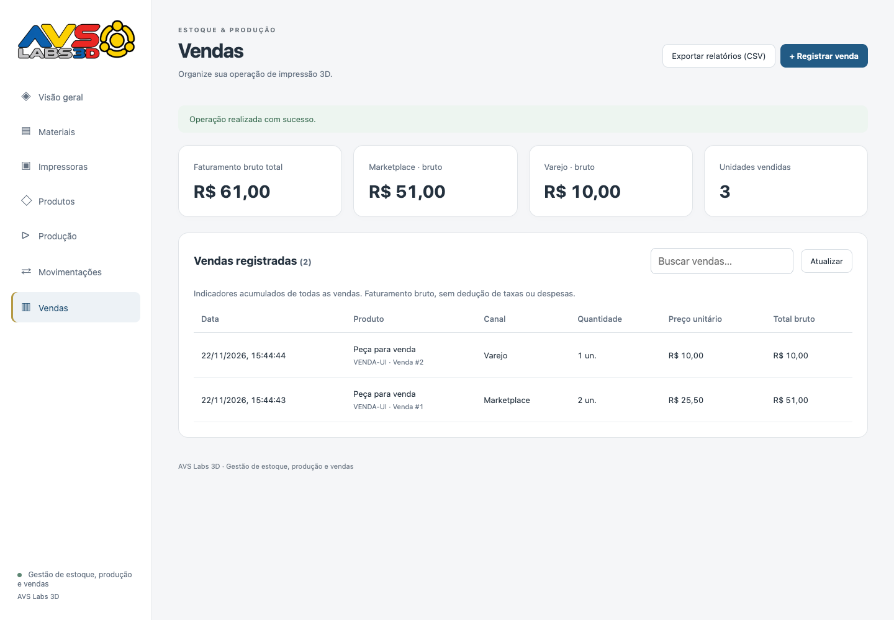

# Manual do usuário

## Abrir e navegar

No Mac configurado, abra o ícone AVS Labs 3D da área de trabalho ou o arquivo Abrir AVS Labs 3D.command na pasta do projeto. O iniciador prepara Docker, PostgreSQL, esquema e interface e abre o navegador. Quando informar sucesso, o Terminal pode ser fechado: o servidor foi iniciado com nohup. Se o sistema já estiver respondendo, apenas abre a página existente.

A visão geral apresenta contagens de filamentos, impressoras, produtos e ordens abertas. O menu dá acesso a Materiais, Impressoras, Produtos, Produção, Movimentações e Vendas. Em telas estreitas, menu e tabelas podem rolar horizontalmente dentro dos próprios contêineres. A busca filtra registros carregados; Atualizar recarrega a API. Após atualização do programa, recarregue a página.

## Cadastrar e repor filamentos

Em Materiais, clique em Novo cadastro. Informe Marca, Material (PLA, PETG, TPU etc.), Cor, Custo por kg e Saldo inicial (g). São três aspectos independentes. Para um rolo de 1 kg, informe 1000 g; também é possível cadastrar frações de grama, com duas casas decimais. Não há quantidade de rolos: o estoque é agregado em gramas para o cadastro selecionado.

O custo por kg não é preço de venda da peça. O valor vigente no cadastro será usado na conclusão da produção para calcular o custo de material consumido. Saldo inicial positivo gera movimento de entrada. Zero é aceito e não cria movimento vazio.

Para repor, clique em Entrada de estoque. Escolha o filamento identificado por marca/material/cor, informe a quantidade que entra e o motivo. O programa soma essa quantidade ao saldo existente. Exemplo: saldo 200 g mais entrada 500 g resulta em 700 g.

## Editar filamento e ajustar saldo

Clique em Editar. O campo Saldo atual (g) representa o total físico que você possui agora. Se o saldo atual é 100 g e você informa 250 g, o programa registra um ajuste positivo de 150 g. Se informa 50 g, registra ajuste negativo de 50 g. O histórico anterior não é apagado.

Não some uma reposição duas vezes: use Entrada de estoque para acrescentar uma quantidade ou Saldo atual para corrigir o total apurado. Se o saldo mudar no banco enquanto o formulário está aberto, o sistema impede a edição com referência antiga. Reabra o cadastro, confira a informação e tente novamente.

## Cadastrar impressoras

Informe Código, Marca, Modelo e Situação. Use códigos como Impressora 01 e Impressora 02 para distinguir duas unidades do mesmo modelo. O código é único mesmo quando muda apenas a combinação de letras maiúsculas/minúsculas.

A situação cadastral disponível indica que a máquina está fora de manutenção. Livre/Ocupada depende da produção em execução. Uma impressora ocupada não pode iniciar outra ordem nem ser colocada em manutenção. Concluir a ordem a libera automaticamente. Uma máquina em manutenção precisa ter sua situação alterada antes de voltar ao uso.

## Cadastrar produtos

Informe Nome e SKU. O SKU é único. O saldo do produto começa em zero e cresce pelas peças aprovadas na produção. A edição muda nome/SKU, mas não oferece saldo manual: a entrada vem da produção e a saída vem da venda.

Cadastros sem vínculos podem ser excluídos após confirmação. Filamentos com movimentos, produtos vendidos ou usados em ordens e impressoras com ordens não podem ser apagados, para preservar o histórico.

## Planejar e executar produção

1. Abra Produção e Nova ordem.
2. Escolha produto, modelo da impressora e código de uma unidade livre.
3. Informe quantidade planejada de peças.
4. Em Filamento 1, selecione Marca, Material e Cor separadamente e informe o consumo estimado em gramas.
5. Para multicor, use Adicionar filamento até quatro linhas. O mesmo cadastro não pode ser repetido.
6. Salve. A ordem fica Planejada e ainda não ocupa a máquina nem consome material.
7. Acione Iniciar. A máquina fica Ocupada.
8. Ao terminar, acione Concluir e informe consumo real por filamento e peças aprovadas.
9. Salve e confira saldos, ordem Concluída e máquina Livre.

A baixa utiliza consumo real, não a estimativa. Uma cor não utilizada pode receber zero; a soma dos consumos deve ser positiva. Aprovadas não podem superar o planejamento. Em falha total, informe zero aprovadas com o consumo efetivo de material.

Se uma cor estiver com saldo insuficiente, a conclusão inteira é revertida: nenhuma cor é descontada parcialmente. Corrija o consumo ou registre uma entrada real de material antes de tentar novamente. Uma ordem já concluída não pode ser concluída outra vez.

## Cancelar e apagar ordem

Uma ordem Planejada pode ser cancelada após confirmação. Uma ordem Cancelada sem movimentos pode ser apagada. Ordens em execução ou concluídas não oferecem exclusão. Trabalho iniciado que falhou deve ser concluído com o consumo e zero aprovadas, em vez de cancelado.

## Registrar vendas

Em Vendas, acione Registrar venda. Escolha um produto com estoque, quantidade, canal Marketplace ou Varejo e preço unitário. O total bruto aparece antes de salvar. A venda reduz o estoque e gera uma movimentação negativa com referência ao registro comercial.

Quantidade acima do disponível é rejeitada. Os indicadores mostram bruto total, bruto por canal e unidades vendidas acumulados em todo o histórico. A busca filtra a tabela, não os indicadores. Não há cálculo de comissão, despesa, taxa, lucro ou recebimento. A versão atual não possui edição, estorno ou exclusão de vendas.

## Movimentações e relatório geral

Movimentações apresentam data, item, quantidade com sinal, motivo e referência. Para filamento, a unidade é grama; para produto, unidade. Saldo inicial, entrada de material e produção aprovada são entradas. Consumo e venda são saídas. Ajustes podem ter ambos os sinais.

Exportar relatórios (CSV) está no cabeçalho de todas as telas. O navegador baixa um ZIP com oito CSVs: visão geral, filamentos, impressoras, produtos, produção, filamentos da produção, movimentações e vendas, além de LEIA-ME. CSV não possui abas; cada seção fica em um arquivo.

Extraia o ZIP e abra os CSVs no Excel/LibreOffice. O formato usa UTF-8 com BOM, ponto e vírgula e vírgula decimal. Datas são UTC em ISO 8601. Todos os registros são exportados, sem aplicar a busca da tela. CSV permite conferência externa, mas não substitui um backup estrutural do PostgreSQL.

## Mensagens e ações

| Situação | Ação do operador |
|---|---|
| Estoque insuficiente | Conferir consumo/quantidade e saldo; registrar entrada verdadeira quando necessário |
| Impressora ocupada | Concluir/aguardar a ordem ativa ou escolher outra unidade |
| Código ou SKU duplicado | Informar uma identificação ainda não usada |
| Cadastro com histórico | Preservar o vínculo; não tentar apagar diretamente no banco |
| Saldo mudou durante a edição | Reabrir e trabalhar com o saldo atualizado |
| Nenhum produto na venda | Concluir produção aprovada ou selecionar produto com estoque |
| Falha de conexão | Conferir Docker, banco e servidor; abrir novamente pelo iniciador |
